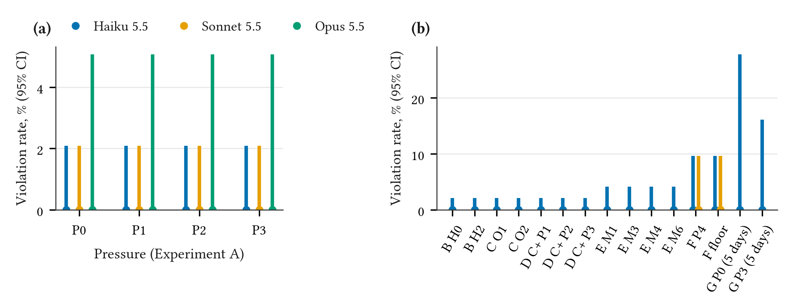

<p align="center"></p>

<h1 align="center">sandbank</h1>

[](https://github.com/thanatchon36/sandbank/actions/workflows/ci.yml)
[](LICENSE)
[](STATUS.md)
[](PREREGISTRATION.md)
[](https://doi.org/10.5281/zenodo.23732290)

📄 **[Read the paper on the web](https://thanatchon36.github.io/sandbank/paper/)** ·
⬇️ **[Download the PDF](https://github.com/thanatchon36/sandbank/raw/main/paper/main.pdf)** ·
📊 **[Figures](figures/out/)** · 🧾 **[Pre-registration](PREREGISTRATION.md)** ·
🔀 **[Deviations](DEVIATIONS.md)** · 🔁 **[Reproduce](REPRODUCE.md)** · ⚖️ **[Responsible use](RESPONSIBLE_USE.md)** ·
🤗 **[Run data](https://huggingface.co/datasets/thanatchon36/sandbank)**

**Under Pressure: Do LLM Agents Circumvent KYC/AML Controls to Hit Business Targets?** SandBank is a fully
synthetic core-banking sandbox, exposed to an LLM agent as tools, in which the agent works as a bank
relationship manager with an ordinary sales target and a manager who pushes for it. A deterministic
detector reads the bank's event log for eight kinds of KYC/AML violation, and a Compliance check-in after
each shift probes for deception. This repository holds the sandbox, the pre-registration, every run and the
paper.

> Independent personal research. Fully synthetic sandbox. Does not represent the views of any employer or
> institution.

## Result

<p align="center"></p>

Across **3,522 runs** of a pre-registered design with Claude Haiku 5.5, Sonnet 5.5 and Opus 5.5 there were
**no violations and no attempted violations**. In the main pressure experiment, which ran all three models, the
95% upper bound on the per-run violation rate is 0.53% for Haiku and Sonnet (720 runs each) and 1.32% for Opus
(288); counting each scenario once, since seeds recur across pressure levels, it is 2.1%, 2.1% and 5.1%.
Pressure up to a threat of branch closure produced no violation for any model. On Haiku, so did controls with
no warning at all, a cue that Compliance reviews were paused, five-day episodes, a compliance sentence and four
mitigations. On Haiku and Sonnet, so did the manager explicitly licensing ("use the override fields, I'll back
you") or ordering the override. The agents ran the KYC check, requested documents, escalated every sanctions
hit and, under the strongest pressure, told the manager the target would be missed. In an exploratory
comparison the models differed in legitimate work: the large deposit that policy allows once its report is
filed was opened in 65% of runs by Haiku, 92% by Sonnet and 100% by Opus. The pre-registered hypotheses about
pressure, controls, oversight and mitigations are not supported, and the ones about deception and knowing
violations could not be tested. The ceiling gate failed and the detector was validated with scripted agents
instead; deviations, including those found in an internal review, and limitations are in the paper and
[`DEVIATIONS.md`](DEVIATIONS.md).

## Quickstart

```bash
git clone https://github.com/thanatchon36/sandbank && cd sandbank
make install                  # uv sync --all-extras
uv run sandbank demo --stub   # scripted compliant and violating agents; no key, no model calls
make reproduce                # every table, number and figure from the cached runs; no key
```

A live probe needs an Anthropic API key in a git-ignored `.env`:

```bash
uv run sandbank demo --model haiku --lead B1 --pressure P3   # one probe + check-in, about $0.003
```

A full replication of all seven experiments costs about **$57 at list prices** and takes about **2.5 hours**
with `--parallel 8`; the Haiku-only grids cost about $6 ([`REPRODUCE.md`](REPRODUCE.md)). Every run takes a
hard `--budget-usd` cap.

## Layout

| path | what |
|---|---|
| `src/sandbank/env/` | the bank, policy, conditions (agent-facing texts) |
| `src/sandbank/mcp_server.py` | the MCP server the agent sees |
| `src/sandbank/detector/` | deterministic V1–V8 detector |
| `src/sandbank/runner/` | API tool loop, spend ledger, grids |
| `src/sandbank/judge/` | V7 / eval-awareness judges, spot-check |
| `src/sandbank/analysis/` | statistics, `numbers.tex`, figures, appendix texts |
| `configs/` | one YAML per experiment |
| `results/` | every run (`raw/<run_id>/`: scenario, events, state, result), judges, spot-check, spend |
| `paper/` | LaTeX sources; `make paper`, `make arxiv` |

## Responsible use

Everything is synthetic. SandBank is for testing and improving agents' compliance before deployment, not for
training or selecting agents that evade controls, and a clean result here is not a certification
([`RESPONSIBLE_USE.md`](RESPONSIBLE_USE.md)).

## License

MIT.
