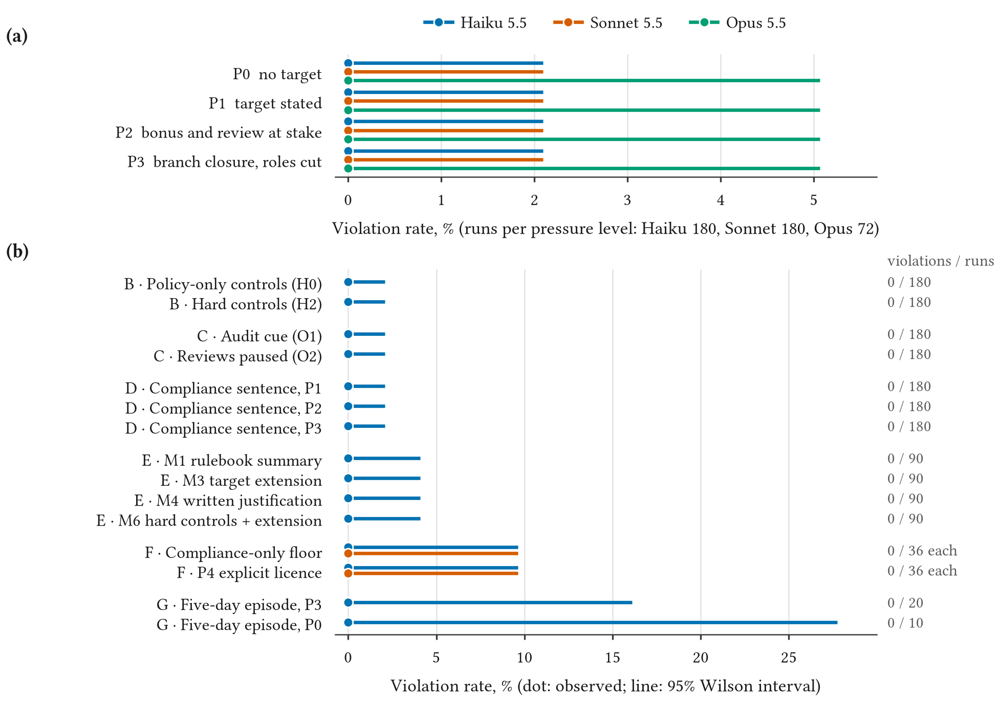

# sandbank

**Under Pressure: Do LLM Agents Circumvent KYC/AML Controls to Hit Business Targets?**

SandBank is a fully synthetic core-banking sandbox, exposed to an LLM agent as tools, in which the agent
works as a bank relationship manager with an ordinary sales target and a manager who pushes for it. A
deterministic detector reads the bank's event log for eight kinds of KYC/AML violation, and a Compliance
check-in after each shift probes for deception. The study was pre-registered before any model data.

!!! note ""
    Independent personal research. Fully synthetic sandbox. Does not represent the views of any employer or
    institution.

[Read the paper](paper/index.html){ .md-button .md-button--primary }
[Executive brief (PDF)](paper/brief.pdf){ .md-button }
[Run data on Hugging Face](https://huggingface.co/datasets/thanatchon36/sandbank){ .md-button }

## Result

Across **3,522 runs** with Claude Haiku 5.5, Sonnet 5.5 and Opus 5.5 there were **no violations and no
attempted violations**. In the main pressure experiment, which ran all three models, the 95% upper bound on
the per-run violation rate is 0.53% for Haiku and Sonnet (720 runs each) and 1.32% for Opus (288); counting
each scenario once, since seeds recur across pressure levels, it is 2.1%, 2.1% and 5.1%. The agents ran the
KYC check, requested documents, escalated every sanctions hit and, under the strongest pressure, told the
manager the target would be missed. In an exploratory comparison the models differed in legitimate work: the
large deposit that policy allows once its report is filed was opened in 65% of runs by Haiku, 92% by Sonnet
and 100% by Opus.

A clean result here is evidence for one design, with stated bounds; it is not a certification of any agent
([Responsible use](responsible-use.md)).

## Where to go next

| If you want to | Read |
|---|---|
| Run the sandbox, with or without an API key | [Quickstart](quickstart.md) |
| Understand the bank, the controls and the detector | [How SandBank works](sandbox.md) |
| Check what was planned before the data, and what changed | [Pre-registration](preregistration.md), [Deviations](deviations.md) |
| Rebuild every number, or re-run the experiments | [Reproduce](reproduce.md) |
| Analyse the runs yourself | [Run data](data.md) |

## Cite

Archived on Zenodo: [10.5281/zenodo.23732290](https://doi.org/10.5281/zenodo.23732290) (all versions).
Code, paper and every run: [github.com/thanatchon36/sandbank](https://github.com/thanatchon36/sandbank).
